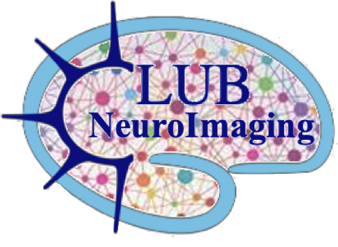

[Accueil](index.md) · [Next meetings](next-meetings.md) · [Past meetings](past-meetings.md) · [Resources](resources.md)

---

# Next meetings 
[visio](https://visio.numerique.gouv.fr/kvx-fogn-rss) (lien permanent pour 2026-2027)
10H30

n°67. 27 Nov. 2026: [Hélène Ratiney](https://www.creatis.insa-lyon.fr/site/fr/users/ratiney) (Creatis Lab, Lyon)

n°68. 18 Dec. 2026: [Laurie-Anne Sapey-Triomphe](https://www.la-sapeytriomphe.fr/) (CRNL, CAP team) for feedbacks on a upcoming study about "structural correlates of hierarchical predictive processing in autism".

n°69. 22 Jan. 2027: special meeting for new students & new colleagues @CRNL

n°70. 12 Feb. 2027

n°71. 26 March 2027

n°72. 30 April 2027

n°73. 28 May 2027: [Fabien Schneider](https://www.univ-st-etienne.fr/fr/tape/notre-equipe.html) (TAPE Unit, Université Jean Monnet, St. Étienne) "Equivalence of tbfMRI and rsfMRI in Evaluating Language Lateralization in Patients with intractable Temporal Lobe Epilepsy"

n°74. 25 June 2027

